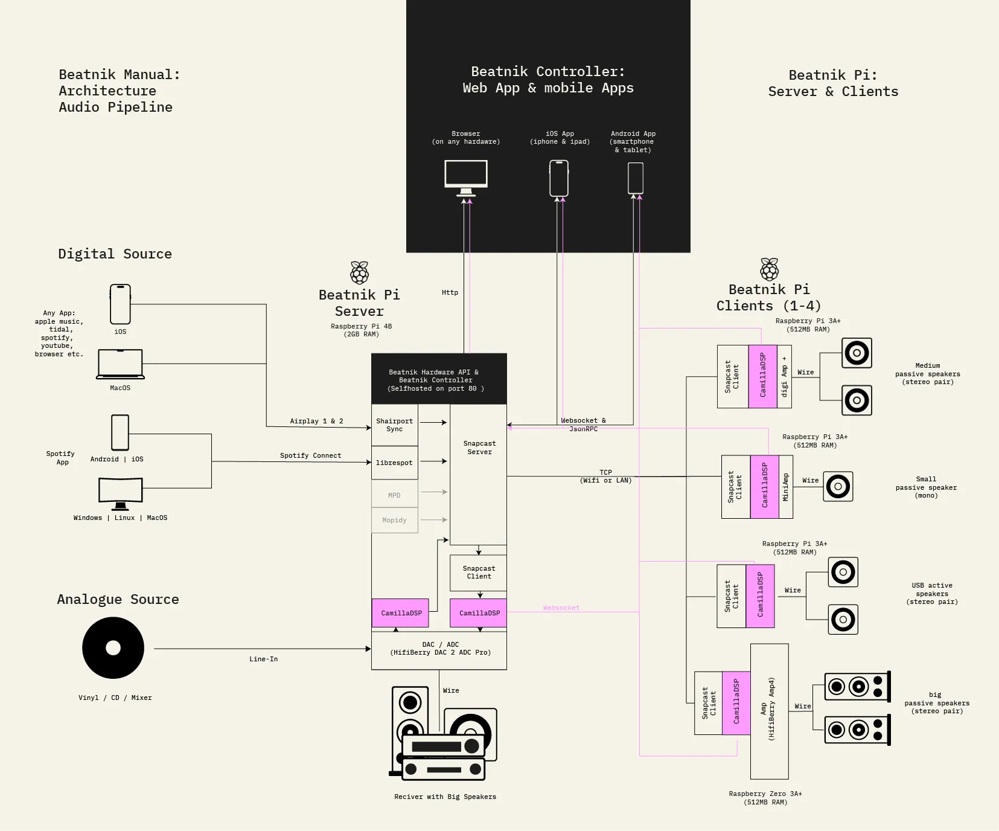

# Architecture & Software Components

## Architecture

For the audio signal path see [Audio Pipelines](../features/pipelines.md).

## Software Components

| Component      | Version / Role                                             |
| -------------- | ---------------------------------------------------------- |
| Raspberry Pi OS Lite/Debian | **Bookworm** / operating system |
| [Snapserver](https://github.com/badaix/snapcast)     | **0.31.0** / receives and distributes streams |
| [Snapclient](https://github.com/badaix/snapcast)     | **0.31.0** / receives and plays streams |
| [Shairport‑Sync](https://github.com/mikebrady/shairport-sync) | **4.3.x** / handles AirPlay 1+2 |
| [Librespot](https://github.com/librespot-org/librespot)      | **x.x** / handles Spotify Connect |
| Device overlay | **HiFiBerry Amp4 Pro** / hardware driver *(swap for your own overlay if needed)* |
| [CamillaDSP](https://github.com/HEnquist/camilladsp)     | **2.0.3** / audio processing, EQ & room correction; service/configuration supplied by the Hardware API |
| [Beatnik Hardware API](https://github.com/byrdsandbytes/beatnik-hardware-api) | Latest release package / soundcard management, hardware control, and CamillaDSP service/configuration |
| [Beatnik Controller](https://github.com/byrdsandbytes/beatnik-controller) | **0.2.1** / Web UI & App – grouping, volume & status |
| [Beatnik Bleno](https://github.com/byrdsandbytes/beatnik-bleno) | **x.x** / Bluetooth Low Energy (BLE) for headless setup / wifi provisioning |
| [Docker](https://www.docker.com/)         | **x.x** – Containerize & host controller |
