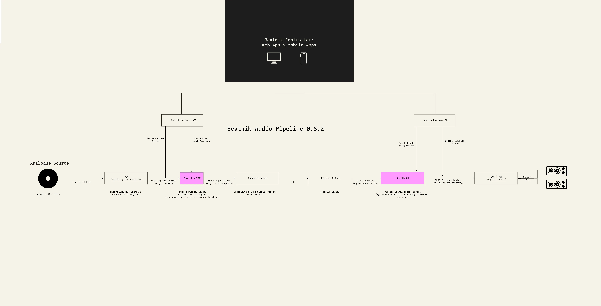

# Beatnik Audio Pipelines

The diagram shows the two audio paths on a Beatnik: the **line-in pipeline**, which digitises and pre-processes an analogue source before it is distributed, and the **playback pipeline**, which processes the signal before it is played. Both are managed from the [Beatnik Controller](../usage/controller.md) through the [Beatnik Hardware API](../advanced/hardware-api.md).

::: info Two separate CamillaDSP instances
Line-In and playback each run their own [CamillaDSP](./dsp.md) instance with separate configs. See [Camilla DSP and Equalising](../usage/guide-camilladsp.md).
:::

## Line-In pipeline

> Analogue Source → ADC → CamillaDSP → Named Pipe (FIFO) → Snapcast Server

| Stage | What happens |
|-------|--------------|
| **Analogue Source** | Vinyl / CD / Mixer, connected with a line-in cable. |
| **ADC** (e.g. HiFiBerry DAC 2 ADC Pro) | Receives the analogue signal and converts it to digital. Read through an ALSA capture device (e.g. `hw:ADC`). |
| **CamillaDSP** | Processes the digital signal before distributing it (e.g. preamping / normalizing / auto-leveling). |
| **Named Pipe (FIFO)** | Hands the signal to the Snapcast server (e.g. `/tmp/snapfifo`). |
| **Snapcast Server** | Distributes & syncs the signal over the local network. |

The Beatnik Hardware API defines the capture device and sets the default configuration of this CamillaDSP instance.

For setting up Line-In by hand, see [Line-In](./line-in.md).

## Playback pipeline

> Snapcast Server → (TCP) → Snapcast Client → ALSA Loopback → CamillaDSP → DAC / Amp → Speakers

| Stage | What happens |
|-------|--------------|
| **Snapcast Server** | Sends the signal to the clients over TCP. |
| **Snapcast Client** | Receives the signal. |
| **ALSA Loopback** (e.g. `hw:Loopback,1,0`) | Passes the signal from the Snapcast client to CamillaDSP. |
| **CamillaDSP** | Processes the signal before playing (e.g. room correction, frequency crossover, biamping). |
| **DAC / Amp** (e.g. Amp 4 Pro) | Plays the processed signal through an ALSA playback device (e.g. `hw:sndrpihifiberry`). |
| **Speakers** | Connected with speaker wire. |

The Beatnik Hardware API defines the playback device and sets the default configuration of this CamillaDSP instance.

For setting up the playback DSP by hand, see [CamillaDSP](./dsp.md).

## Controlling the pipelines

The Beatnik Controller (web app and mobile apps) talks to the Beatnik Hardware API on the line-in side and on the playback side. See [Camilla DSP and Equalising](../usage/guide-camilladsp.md) for the controls.
