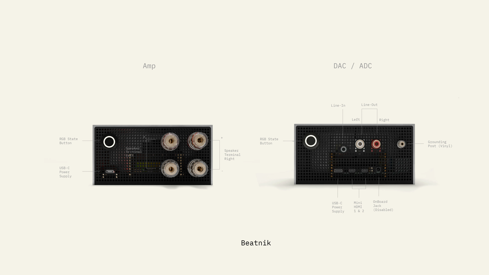

# Choosing the Right Hardware

Source: [beatnik.audio – Getting Started](https://beatnik.audio/blogs/docs/getting-started)

## 1. What do you already have?

The first question you should answer for yourself is:

- What do you already have?

Depending on your existing hardware you can build or buy a Beatnik device that suits your needs.

There are 2 paths:

1. **Amplifier** if you have passive speakers. (Most vintage speakers are passive)
2. **DAC** (Digital Analog Converter) if you have an existing music system, active speakers, an amp or a receiver.

### DAC or Amp?

In the image above you see a DAC/ADC on the right which has stereo output & input. You can use it to connect to your receiver, active speakers, subwoofers, or analogue amp. (Line-In is in the making but we're still testing that feature)

The Amp on the left has 4 binding posts as output. You can directly connect your passive speakers to those, using speaker wire (directly or using banana plugs).

## 2. Plug & Play or self-built?

Next question: Plug & Play or completely self-built? You decide. There are 3 ways to get a Beatnik device:

1. Build **everything from scratch**, organize everything yourself or order components from us. Install it using the CLI or flash an SD card with BeatnikOS yourself.
2. Get a **curated bundle** with all the components and preinstalled software. You just have to assemble it. (Which is fun). We'll give you IKEA-like manuals to do so.
3. Get a **Plug & Play device** that just works. We assemble it for you, test everything in detail and ship it to you.

## 3. Choose your quality

You can build Beatnik devices in various quality. From "cost optimized" to "audiophile grade hardware".

It's up to you to decide what you need.

- More computing power, because you want to use crazy mixers & filters or even run it as homelab? -> Choose a Raspberry Pi with more RAM and GHz
- Are you an audiophile? -> Choose a high end audio board.
- Wanna connect your vinyl player? -> Choose an audio board that has line-in (DAC/ADC).

## Next

See the [Hardware Examples](./overview.md) for example parts lists.

Curated bundles, components and Plug & Play devices are available at [beatnik.audio](https://beatnik.audio).
