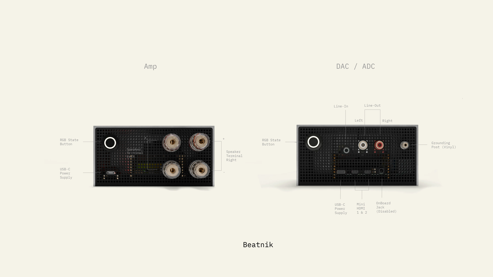
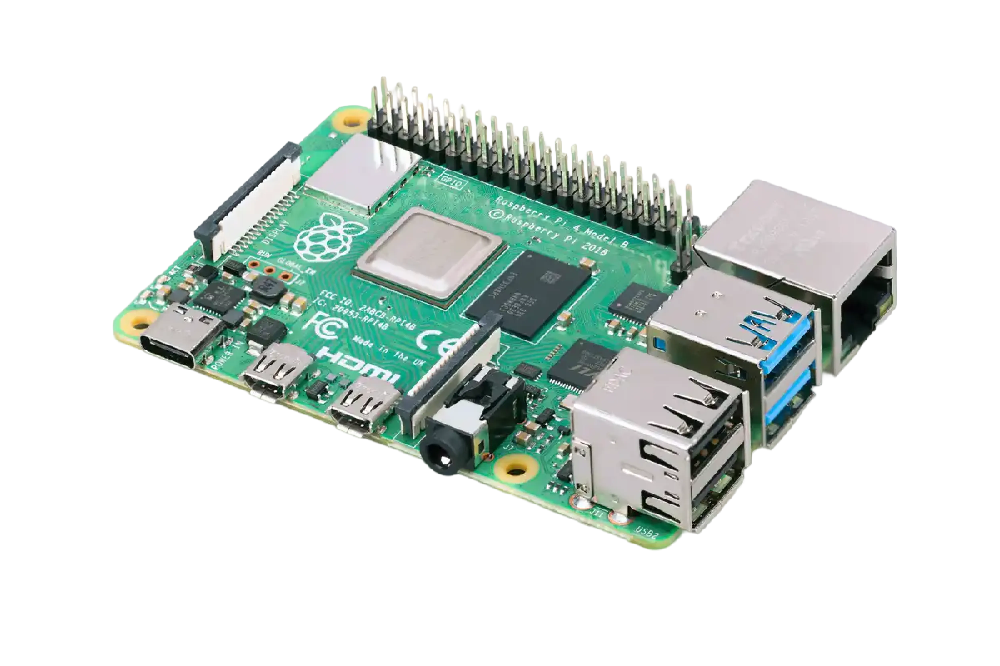
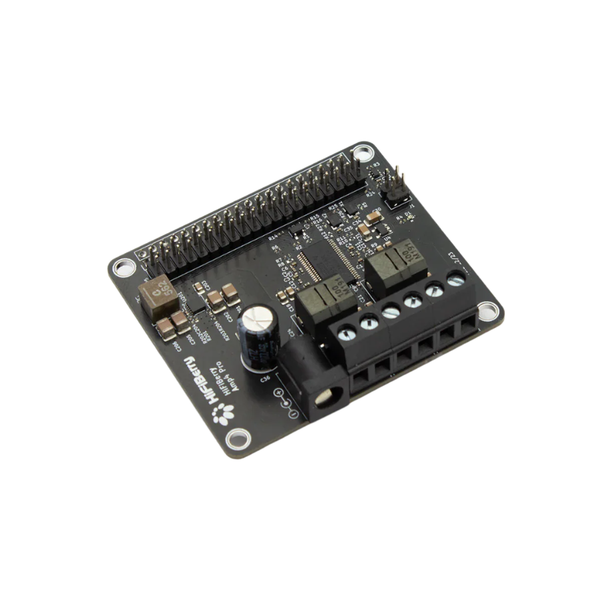
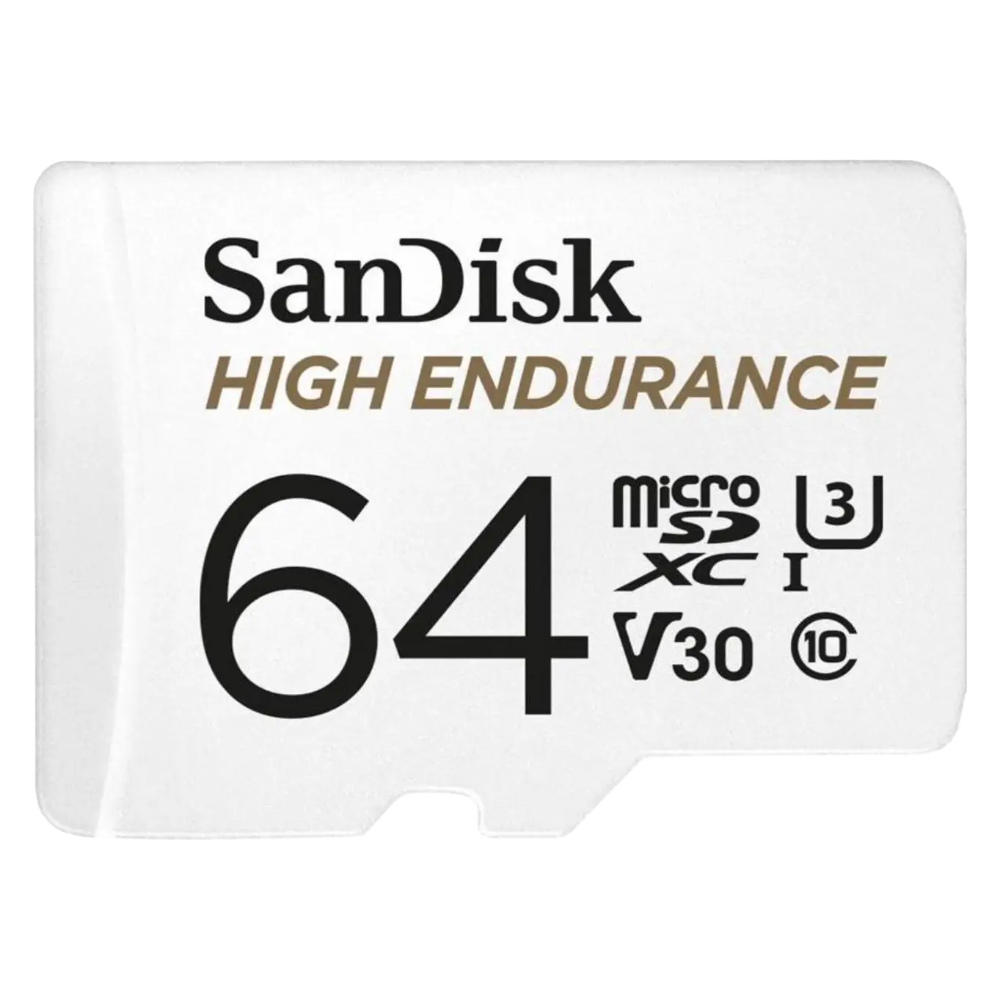
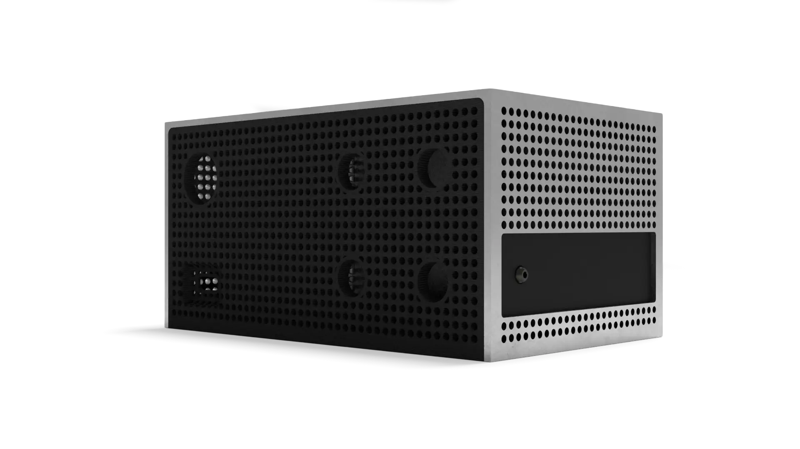
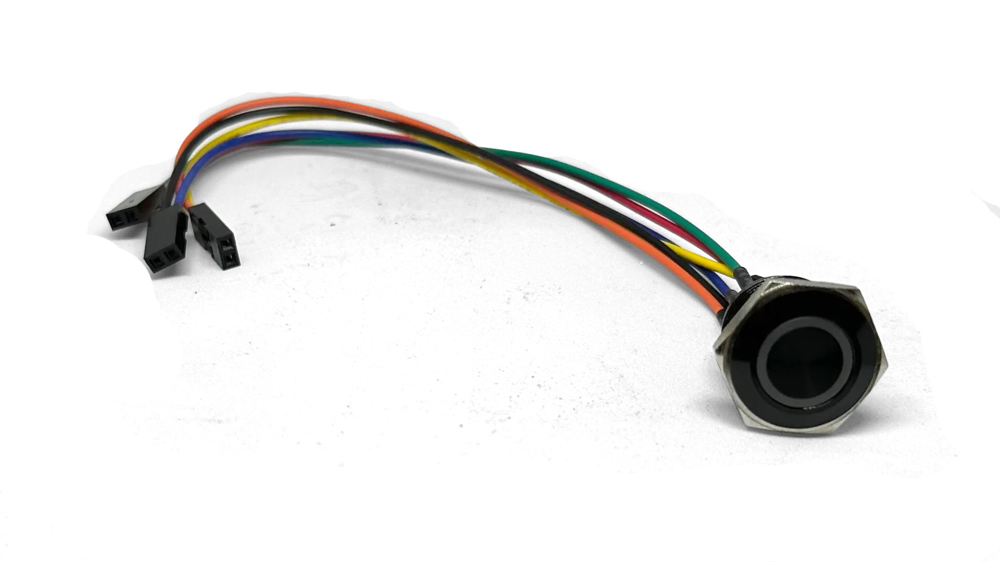
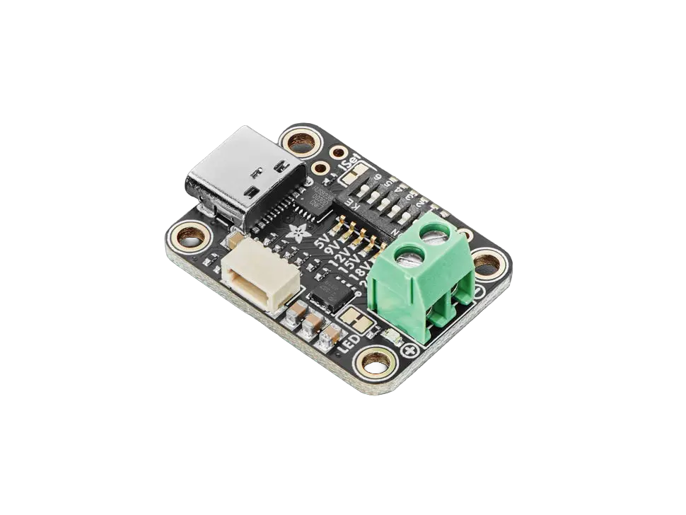
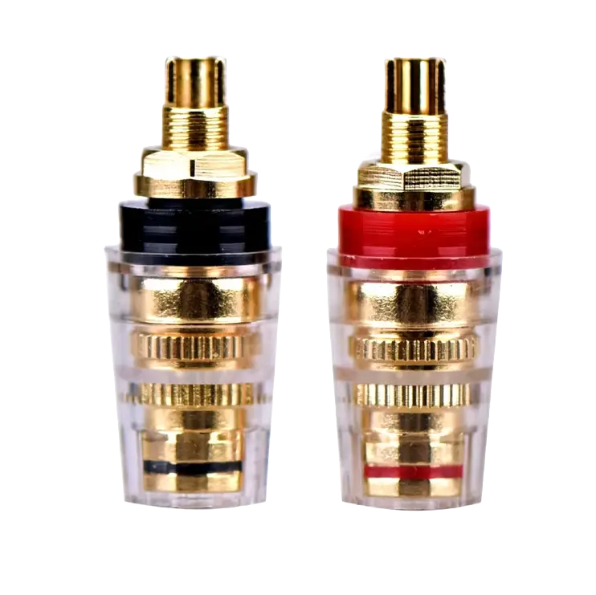
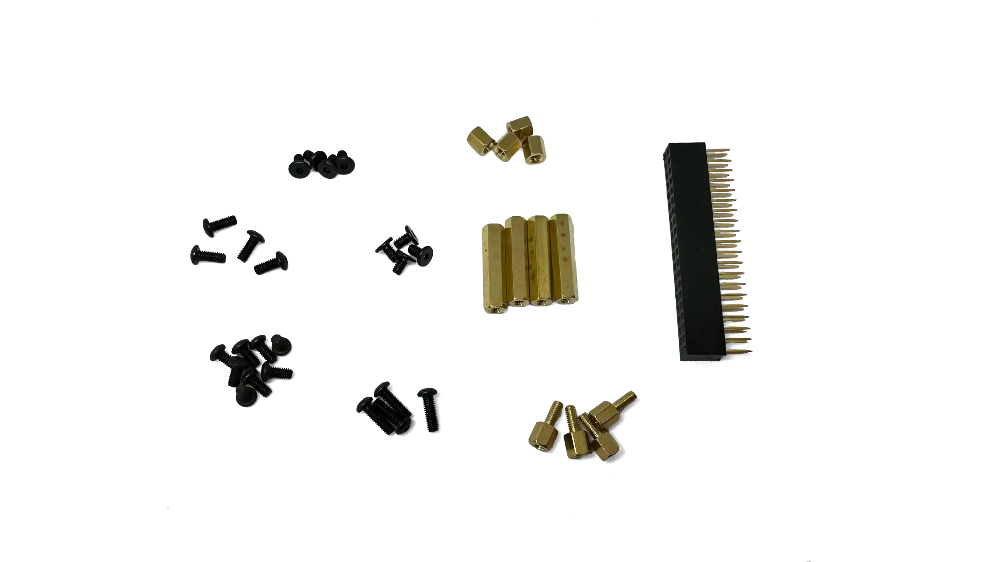

# Hardware Examples

::: tip
Prefer not to source the parts yourself? Components, curated bundles and Plug & Play devices are available at [beatnik.audio](https://beatnik.audio).
:::

## Beatnik Server (Amp Pro)

| Part               | Notes                                                | Image |
| ------------------ | ---------------------------------------------------- | ----- |
| **Pi 4B**           | 2GB recommended but 1GB will work for most server usecases |  |
| **HiFiBerry Amp4 Pro** | Just Plug it on your GPIOs       |  |
| **Micro SD Card** | High Quality/Endurance Recommended. Stores the operating system and software  |  |
| **Beatnik Unibody Case** *(optional)*  | Currently working on case, check   [our subbredit r/beatnikAudio](https://www.reddit.com/r/beatnikAudio/) to see the progress. |  |
| **Beatnik RGB Button** *(optional)* | Connects via GPIO, used for state indication, restart, reset and wifi provisioning |  |
| **Adafruit USB-C PD Board** *(optional)* | Provides 18V power delivery for the Amp & Pi and connected peripherals |  |
| **65 W USB-C Power Supply** *(optional)*   | Amp4 is powered via PD Board and the pi via GPIO            |       |
| **Binding Posts** *(optional)* | Provides connection points for external speakers |  |
| **Gpio Spacer, Screws & PCB Stands** *(optional)* | Provides physical support and spacing for better heat management |  |

## Beatnik Client (Amp Light)

| Part               | Notes                                                |
| ------------------ | ---------------------------------------------------- |
| **Pi 3B**           | 1GB recommended but 512MB will work for most client usecases |
| **HifiBerry Amp 2** | Just Plug it on your GPIOs       |
| **Power Supply**   | Amp is powered via  GPIO            |
| **3d Printed Custom Case**   | Currently working on cases, check   [our subbredit r/beatnikAudio](https://www.reddit.com/r/beatnikAudio/) to see the progress.         |
