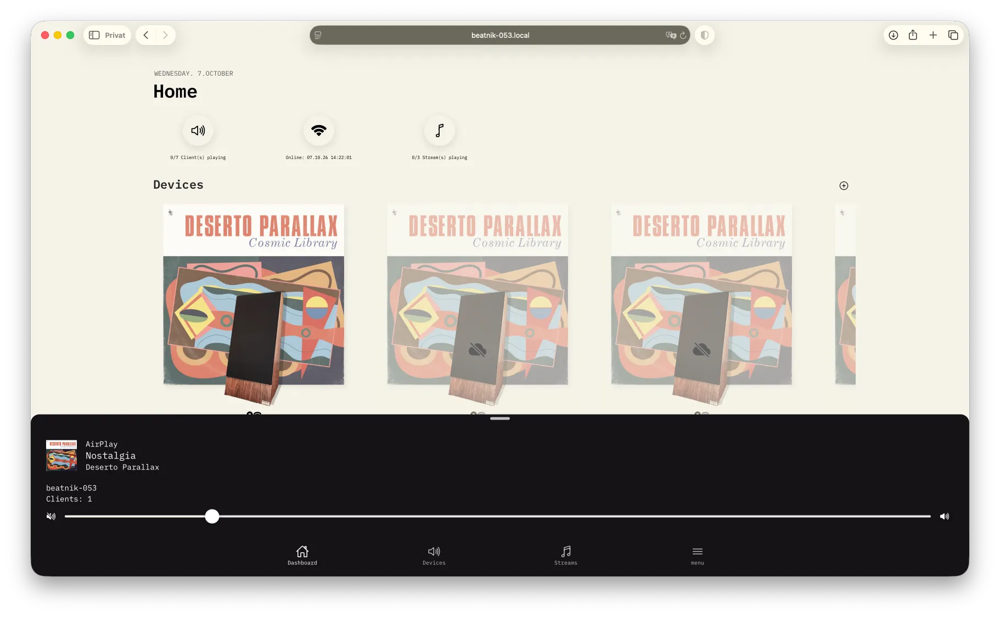
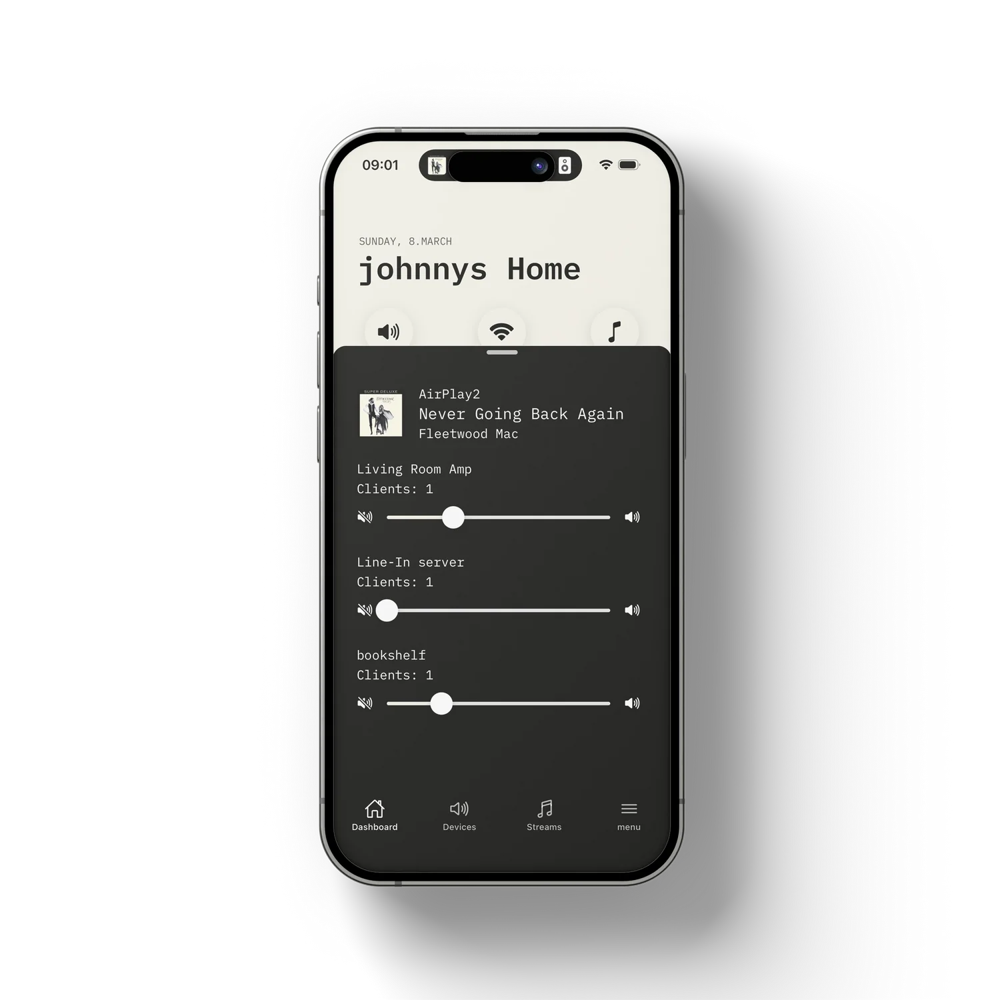
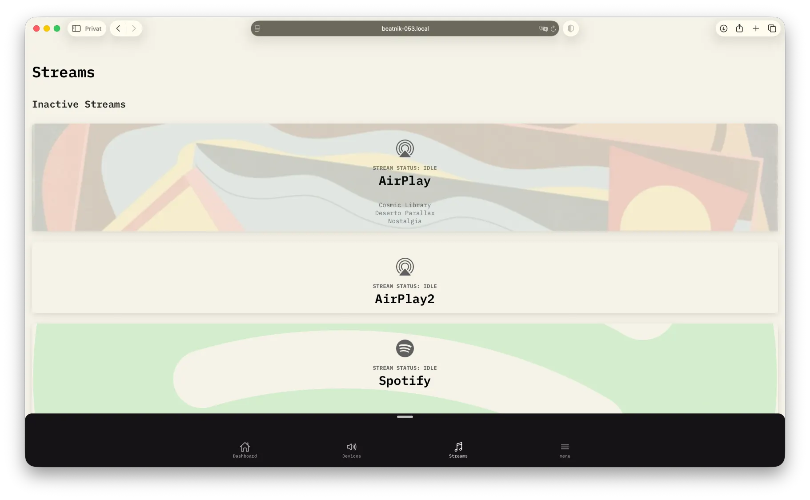
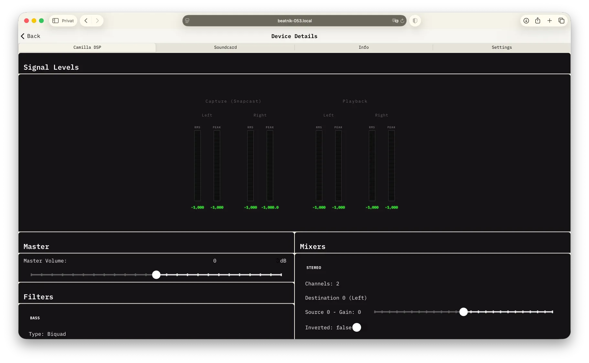

# Using the Beatnik Controller

The Beatnik Controller lets you manage your Beatnik Pi or Snapcast multi-room audio system from a browser or the iOS and Android apps. Use it to control playback across rooms, manage devices and adjust audio settings.

## What you can do

- **Multi-room control:** group clients, adjust room volumes and see what's playing.
- **Streams and presets:** assign sources to groups and save volume and stream setups for one-tap recall.
- **CamillaDSP:** monitor levels and adjust EQ, master volume, mixers and dynamics for playback or Line-In, depending on the active configuration.
- **Device setup and discovery:** set up Beatnik devices using Bluetooth Low Energy (BLE) and Wi-Fi, and search for devices on your network (mobile apps only).
- **Updates:** check installed versions and update Beatnik software components from the app.
- **Device management:** choose soundcards, inspect device and network status, and reboot devices.
- **Server maintenance:** inspect server status, remove offline clients and restart Snapcast services.

## Get the controller

### iOS and Android

Download the app from the [App Store](https://apps.apple.com/ch/app/beatnik-audio/) or [Google Play](https://play.google.com/store/apps/details?id=ch.byrds.beatnik). The mobile app also supports network scanning and adding a device using Bluetooth and Wi-Fi.

### Web app

The controller is pre-installed in Beatnik OS. On the same network as your server, open its hostname or IP address in your browser, for example `http://beatnik-042.local/` or `http://192.168.1.100`.

For other setups, see [Controller Docker Setup](./controller-docker.md). The web and mobile apps share the main controls; see [Web vs. mobile app](./guide-settings-help.md#web-vs-mobile-app) for the differences.

## Get started

1. Open the mobile or web app.
2. Connect to your Beatnik or Snapcast server. If the app cannot find it, enter its address in **Menu > Settings**, or use the network scanner in the mobile app. See [Connecting to your server](./guide-getting-around.md#connecting-to-your-server).
3. Use the **Dashboard**, **Devices** and **Streams** tabs to explore your system. For a new Beatnik, follow [Adding a New Beatnik Device](./guide-add-device.md).

You can also explore the app without hardware using [Demo mode](./guide-settings-help.md#demo-mode).

## Streams and sound

The **Streams** tab shows available sources and their status. See [Everyday Use](./guide-everyday-use.md) for stream assignments, groups and presets.

For sound adjustments, open a device's **Camilla DSP** tab. The available controls depend on its active configuration. See [Camilla DSP and Equalising](./guide-camilladsp.md) for EQ, signal levels, mixers and advanced settings.

## Controller guide

For more detail, explore the guide:

1. [Getting Around](./guide-getting-around.md) - concepts, connecting to your server and the app layout.
2. [Everyday Use](./guide-everyday-use.md) - dashboard, devices, streams and presets.
3. [Adding a New Beatnik Device](./guide-add-device.md) - Wi-Fi, server, audio and group setup.
4. [Camilla DSP and Equalising](./guide-camilladsp.md) - EQ, master volume, mixers, dynamics and config files.
5. [Device Maintenance & Updates](./guide-maintenance.md) - device details, updates, server status and the network scanner.
6. [Settings & Help](./guide-settings-help.md) - settings, demo mode, web vs. mobile app and troubleshooting.

The controller source code is available on [GitHub](https://github.com/byrdsandbytes/beatnik-controller).
