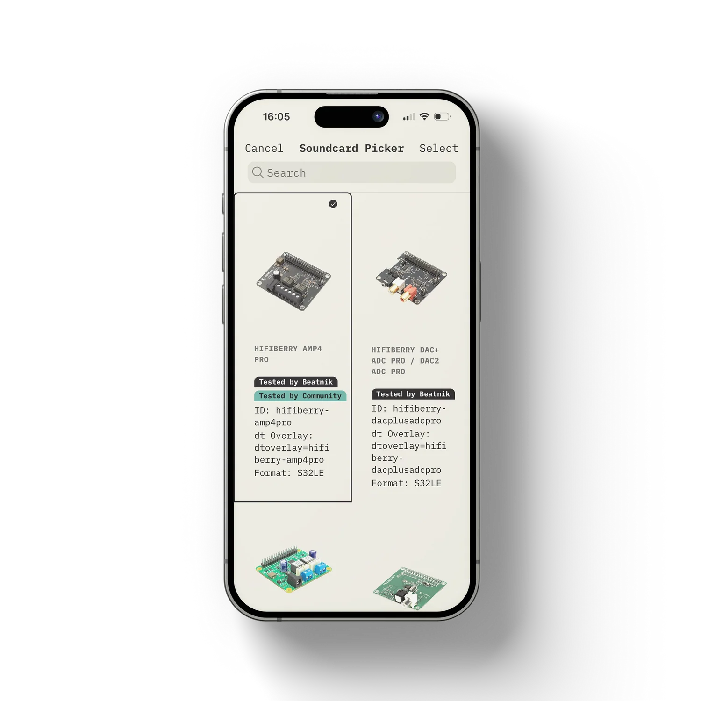

# Adding a New Beatnik Device

Tap **+** on the dashboard (or the big button on the onboarding card) to start the setup. Setup runs in the **mobile app** and uses Bluetooth Low Energy.

### Step 1 - Wi-Fi setup (`Network Configuration`)

::: warning 📸 Screenshot needed
Network Configuration step: Scan for Devices and the list of Wi-Fi networks.
:::

1. Plug in your Beatnik. Hold the setup button for 5 seconds until the LED pulses blue.
2. Make sure your phone is connected to your home Wi-Fi (the app warns you if it is on cellular).
3. Tap **Scan for Devices** and wait for the app to find and connect to the Beatnik.
4. Pick one of the Wi-Fi networks the Beatnik found (name, signal quality, security and band are shown).
5. Enter the Wi-Fi password (use the eye icon to reveal it) and start provisioning.
6. Wait for the connection status. When the Beatnik is online, its IP address, hostname and device ID are shown. Tap **Continue**.

### Step 2 - Server setup (`Configure Device`)

::: warning 📸 Screenshot needed
Configure Device step: Setup as Server / Setup as Client.
:::

The app searches for existing Snapcast servers on your network:

- **First Beatnik device:** it is configured as your **Snapcast Server**. Tap **Setup as Server**, or **Setup as Client** to override.
- **Server already exists:** you are asked whether to set the device up as a **Snapcast Client** (**Yes, Setup as Client**). Choosing **No, Setup as Server** shows a warning, because multiple servers can cause conflicts.

The app then validates the connection to the server.

### Step 3 - Audio setup

Choose the soundcard configuration:

- **Detected Soundcard** - use the hardware the Beatnik detected automatically.
- **Manual** - select your soundcard from the list and tap **Apply Manual Soundcard Config**. Some soundcards cannot be detected automatically.

Tap **Continue** when finished.

### Step 4 - Name the device group

::: warning 📸 Screenshot needed
Name the device group screen with Save & Complete Setup.
:::

Give the device a descriptive name such as "Living Room Amp" or "Kitchen Audio" and tap **Save & Complete Setup**. A group can contain a single device or several.
