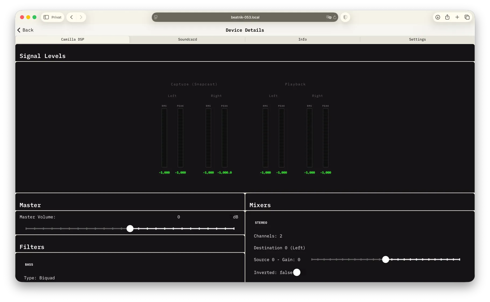
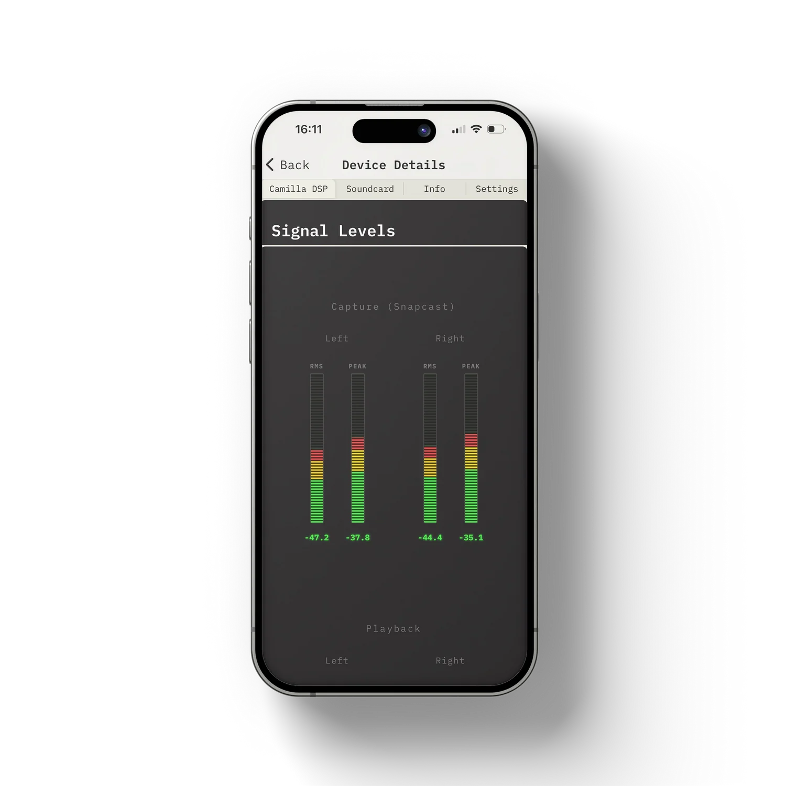
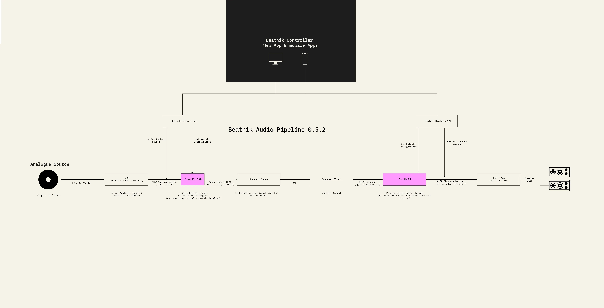

# Camilla DSP and Equalising

[CamillaDSP](https://github.com/HEnquist/camilladsp) is the audio processing engine on each Beatnik. It sits between Snapcast and the soundcard and is what makes equalising, volume trim, channel mixing and dynamics control possible. The app talks to it live, so you can hear every change while you make it.





- **Level meters:** view signal levels for **Capture (Snapcast)** and **Playback**, left and right. Switch the display style between **Bars**, **Gauge**, **Lines** and **Rotary**.
- **Master volume and gain:** adjust in dB using sliders or rotary knobs.
- **Mixer:** channel source gains with *Inverted* and *Muted* toggles.
- **Processors:** per-channel processing blocks (for example dynamics and soft clip).
- **Default config:** pick a CamillaDSP configuration file stored on the device (with search) and save it as the default.
- **Advanced:** connect/disconnect and inspect the DSP state, configuration (JSON/YAML), update interval and signal levels.

## How it works



CamillaDSP processes audio as a pipeline defined in a **config file** stored on the device. A typical Beatnik pipeline looks like this (the exact order and content depend on the config):

```
Snapcast audio (capture) > Mixer > Filters (EQ) > Processors (compressor) > Soundcard (playback)
```

| Block | What it does | Controls in the app |
|-------|--------------|---------------------|
| **Master volume** | Overall level of the device in dB. | Adjustable |
| **Filters** | The equaliser. Each filter is one EQ band, for example a bass boost or treble cut. | Gain adjustable. Type, frequency and Q are shown but read-only |
| **Mixers** | Routes input channels to output channels. | Per-source gain, invert and mute |
| **Processors** | Dynamics processing (compressor) and soft clipping. | Threshold, ratio, attack, release, makeup gain, soft clip |

The filters, mixers and processors you see depend entirely on the active config file. If a block does not exist in the config, it is not shown in the app.

::: info Two separate CamillaDSP instances
Line-In and playback (line out) each run their own CamillaDSP instance. The playback DSP is the one on the soundcard output. The line-in (preamp) DSP is a separate instance, managed under the Line-In stream; it processes the analog input before it is sent to Snapcast. Each has its own config file and its own settings.
:::

## Opening the controls

| Where | What you control |
|-------|------------------|
| **Devices > Clients > (client) > Camilla DSP tab** | The playback DSP of that device. |
| **Streams > Line-In** | The separate line-in (preamp) DSP, shown only for the Line-In stream. |

The app connects automatically and shows *Connecting to CamillaDSP...* and *Loading configuration...* while it waits. If the device cannot be reached, a message with a **Retry** button appears and the app retries every few seconds. If no address is known for a device, open it from the device list or the network scanner, or set the server address in [Settings](./guide-settings-help.md#settings).

## Equalising

The **Filters** section is your equaliser. Every filter in the config appears as a card with:

- **Name** - the filter name from the config, for example `bass` or `treble`.
- **Type** - the filter type (for example a shelf or peaking filter). Read-only.
- **Gain** - the amount of boost or cut in dB. This is the control you adjust.
- **Frequency** and **Q** - where the filter acts and how wide it is. Read-only.

::: warning 📸 Screenshot needed
Filters section with the filter cards (for example bass and treble) and their gain sliders.
:::

To equalise:

1. Open the **Camilla DSP** tab of the device you want to adjust.
2. Start music so you can hear the effect.
3. Find the filter card for the band you want to change (for example the bass band).
4. Drag the slider or knob, or type a value into the number field. The range is -12 dB to +12 dB in 1 dB steps on sliders and knobs.
5. Repeat for the other bands. Use gentle changes: a few dB is usually enough, and large boosts can cause clipping.

Tips:

- **Cut rather than boost.** If something sounds too harsh, reduce that band instead of raising the others. Lowering the master volume slightly before boosting avoids distortion.
- **Check the playback meters.** If the peak reaches 0 dB, reduce the gain or enable **Soft clip** (see [Processors](#processors-dynamics)).
- **Different bands or frequencies:** the app changes only the gain. To change frequencies, Q or filter types, pick a different config file under [Advanced settings](#advanced-settings-config-files).
- **Per device:** every client has its own EQ, so you can tune each room separately.

::: info
Gain changes are sent to the running CamillaDSP immediately but are not written to the config file by the app. If CamillaDSP restarts, or you apply a config with **Set as default**, the values from the config file are used again.
:::

## Master volume

**Master** controls the overall level of the DSP in dB. Type a value or use the slider or knob. This is separate from the Snapcast volume you set in the player toolbar and in volume presets. Use it to set a sensible overall level and leave the Snapcast volume for day-to-day changes.

## Mixers

Each mixer card shows its output channel count and, for every destination channel (the first is Left, the second Right), its source channels with:

- **Source gain** - level of that source in dB (-12 to +12).
- **Inverted** - flips the polarity of the signal. Use it to fix speakers that are wired out of phase.
- **Muted** - silences that source.

Mixers are useful for channel balance, swapping left and right, or muting one side while testing.

::: warning 📸 Screenshot needed
Mixers section with a mixer card, showing source gain, Inverted and Muted.
:::

## Processors (dynamics)

If the config contains a compressor, each processor card shows its name and type, plus the channels it works on (**Total**, **Monitor** and **Process**). The following controls are available:

| Control | Range | Effect |
|---------|-------|--------|
| **Threshold** | -60 to 0 dB | Level above which compression starts. |
| **Ratio** | 1 to 20 : 1 | How strongly levels above the threshold are reduced. |
| **Attack** | 0.001 to 1 s | How quickly compression engages. |
| **Release** | 0.01 to 2 s | How quickly compression lets go. |
| **Makeup gain** | 0 to 24 dB | Level added after compression to compensate for the reduction. |
| **Soft clip** | On / Off | Gently rounds off peaks instead of hard clipping. |
| **Clip limit** | -24 to 0 dB | Level at which soft clipping starts. Shown when Soft clip is on. |

Applying processor changes restarts the audio pipeline, so the app waits until you stop dragging before it sends the change. Expect a brief interruption in the audio while the change is applied.

::: warning 📸 Screenshot needed
Processors section with a compressor card and the Soft clip toggle.
:::

## Signal levels

The **Signal Levels** section at the top shows what is flowing through the DSP, updated continuously for left and right channels:

- **Capture (Snapcast)** - the audio arriving from the stream.
- **Playback** - the audio leaving towards the soundcard, after your EQ and processing.

Each meter shows the RMS (average) level and the peak level. Switch the display with **Bars** or **Gauge**. The gauge scale runs from -60 dB to 0 dB. Comparing capture and playback tells you how much gain your settings add.

## Control style

The **Master** header has a **Lines** / **Rotary** switch. **Lines** shows sliders with number fields. **Rotary** shows knobs. The choice applies to all controls (master, filters, mixers and processors). The meter style and control style are remembered on your device.

## Advanced settings (config files)

At the bottom, **Advanced Settings** lets you choose which CamillaDSP config file the device loads by default. Only change this if you know what you are doing, because the config defines the whole pipeline (EQ bands, mixers, processors and soundcard format).

1. Tap the config button to open the **Select a config** list.
2. Search by file name. The config that is currently active is marked **Current**.
3. Tap a file. The picker closes and the file is selected (press **Done** to close the list without choosing).
4. Tap **Set as default**. The device applies the config and CamillaDSP restarts. A confirmation shows the new default.
5. **Refresh** reloads the list of config files and the current default.

For the **Line-In** stream the same section manages the config of the line-in (preamp) DSP, which is a separate CamillaDSP instance from the playback DSP. This only works if a preamp is set up on the device.

At the very bottom, the collapsible **CamillaDSP Connection** section shows the WebSocket address, the connection status and the raw messages and configuration. It is meant for debugging.

::: warning 📸 Screenshot needed
Advanced Settings with the "Select a config" list and the Set as default button.
:::

## Troubleshooting Camilla DSP

| Problem | What to try |
|---------|-------------|
| *CamillaDSP not reachable* | Check the device is on and on the same network, then tap **Retry**. |
| *No configuration received* | CamillaDSP is connected but has no config loaded. Pick one under Advanced settings. |
| No filters or processors shown | The active config does not define any. Choose a different config file. |
| Distortion after boosting | Lower the gain of the boosted band or the master volume, or enable **Soft clip**. |
| "No config files found on this device" | The device returned no config files. Make sure the device is online and up to date (see [Updates](./guide-maintenance.md#updates)). |
| Line-In config list fails to load | No line-in (preamp) is set up on this device. |
| EQ changes disappeared | Gain changes are live only. They reset when CamillaDSP restarts or a config is applied. |
