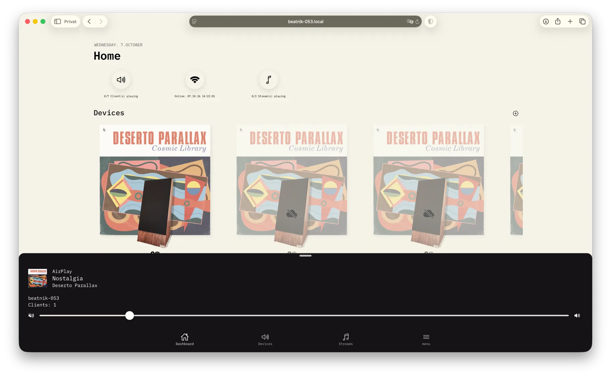
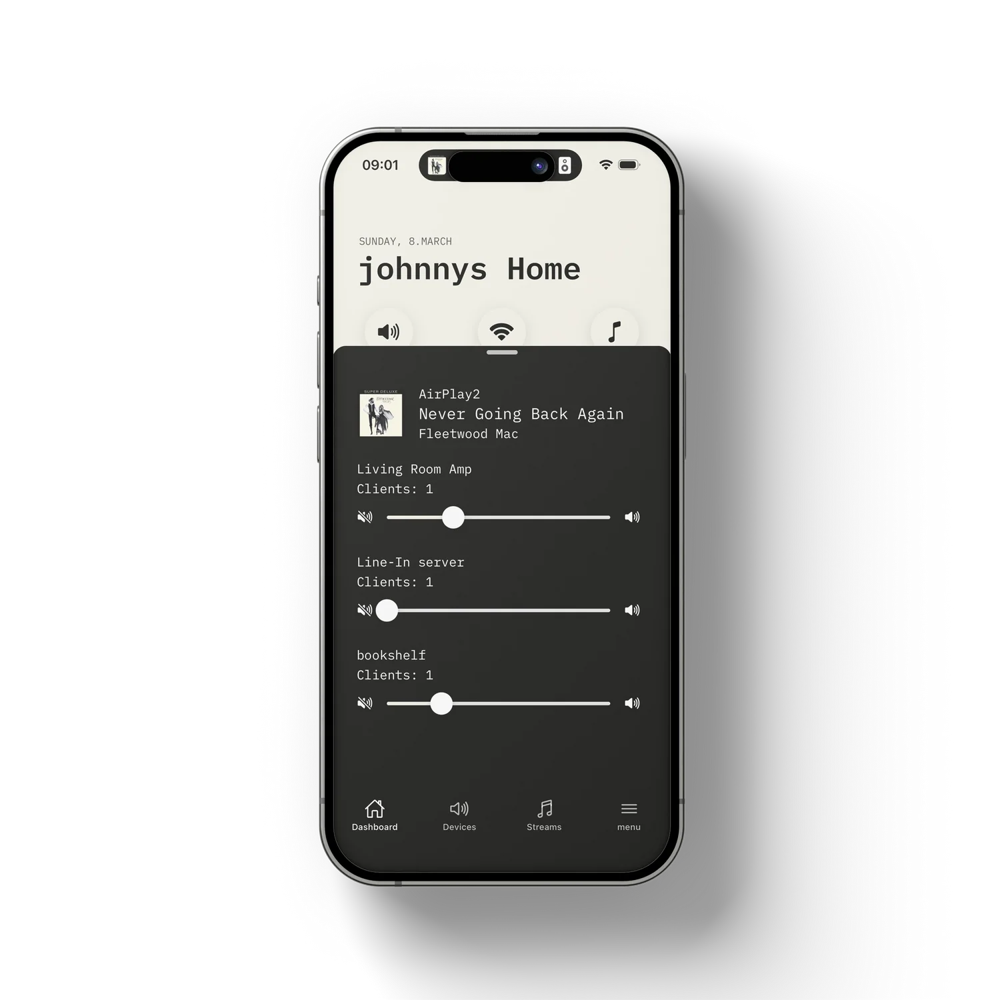
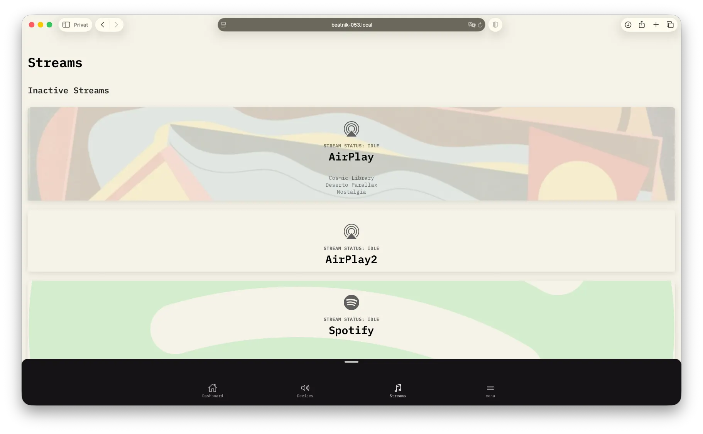

# Everyday Use

## Dashboard

The dashboard greets you with your name (set in [Settings](./guide-settings-help.md#settings)) and the current date.

### Quick-action buttons

::: warning 📸 Screenshot needed
Close-up of the three round quick-action buttons.
:::

Three round buttons at the top show live status and double as shortcuts:

| Button | Shows | Tap to open |
|--------|-------|-------------|
| Volume icon | `playing / total` clients | [Volume presets](./guide-everyday-use.md#volume-presets) |
| Wi-Fi icon | Online/Offline and the time of the last server response | [Server status](./guide-maintenance.md#server-status-and-maintenance) |
| Music note icon | `playing / total` streams | [Stream presets](./guide-everyday-use.md#stream-presets) |

### Devices carousel

Swipe through your connected device groups. Each card shows:

- The speaker image chosen for the group
- Album art, title, artist and album of the current stream
- A play/stop status icon and a Wi-Fi icon per client (greyed out when disconnected)
- The group name

Actions:

- **Tap** a card to open the [device details](./guide-maintenance.md#device-details-and-maintenance).
- **Long-press** a card to choose a different [speaker image](./guide-maintenance.md#speaker-image).
- Offline groups appear with a cloud-offline overlay.
- Tap the **+** icon next to *Devices* to [add a new device](./guide-add-device.md).

### Streams carousel

Swipe through all streams with their status (`playing` / `idle`), source icon and metadata. Tap a stream to open its details.

### Pull to refresh

Pull down on the dashboard to reload the server state.

---

## Devices

::: warning 📸 Screenshot needed
Devices tab with the Clients and Device Groups lists.
:::

The **Devices** tab has two lists:

- **Clients** - every client with its name, ID, group, volume, last-seen time and connection state. Tap a client to open its [client details](./guide-maintenance.md#client-details).
- **Device Groups** - every group with its number of clients. Tap a group to open its [device details](./guide-maintenance.md#device-details-and-maintenance).

---

## Streams

The **Streams** tab lists all streams. Active (non-idle) streams appear first, followed by **Inactive Streams**. Each card shows the stream name, status, source icon and the current album art, album, artist and title.

### Stream details

::: warning 📸 Screenshot needed
Stream details view, including the collapsible JSON section.
:::

Tap a stream to see its details:

- The raw stream configuration in a collapsible JSON section (useful for debugging).
- For the **Line-In** stream, the [Camilla DSP](./guide-camilladsp.md) controls are shown in `linein` mode.
- For the **Hof-Bar-Radio** stream, a Mopidy player with stop / play / pause buttons and an **Initialize Hof-Bar Radio** button is shown.

---

## Volume presets

::: warning 📸 Screenshot needed
Volume presets list with an expanded swipe action.
:::

Volume presets store the volume of every client so you can switch between listening scenarios (for example "Party", "Night", "Dinner").

Open them from the dashboard (volume button) or directly at `/volume-presets`.

| Action | How |
|--------|-----|
| **Apply** | Tap a preset. A toast confirms when all volumes are set. |
| **Edit** | Swipe the preset to the right and tap the pencil. |
| **Delete** | Swipe the preset to the left and tap the trash can. |
| **Create** | Tap **Create / Capture Preset**. |

### Creating a preset

::: warning 📸 Screenshot needed
Capture Preset screen with per-group sliders and the Save Preset prompt.
:::

1. Set your speakers to the desired volumes (for example in the player toolbar).
2. Tap **Create / Capture Preset**, then **Capture Preset** to record the current volume of every group.
3. Fine-tune each group with its slider (0-100 %).
4. Tap **Save Preset**; a prompt asks for a name and an optional description.

When editing, **Re-Capture Current Setup** replaces the stored values with the current live volumes.

---

## Stream presets

::: warning 📸 Screenshot needed
Stream presets screen with a stream selector per group and the Quick Assign All list.
:::

Stream presets store which stream is assigned to which group, so you can re-route the whole house in one tap.

Open them from the dashboard (music-note button) or directly at `/stream-presets`. Creating, editing, applying and deleting work like [volume presets](./guide-everyday-use.md#volume-presets), but each group has a **stream selector** instead of a volume slider.

**Quick Assign All** lists automatically generated presets of the form *"All to \<stream\>"* that assign one stream to every group.
