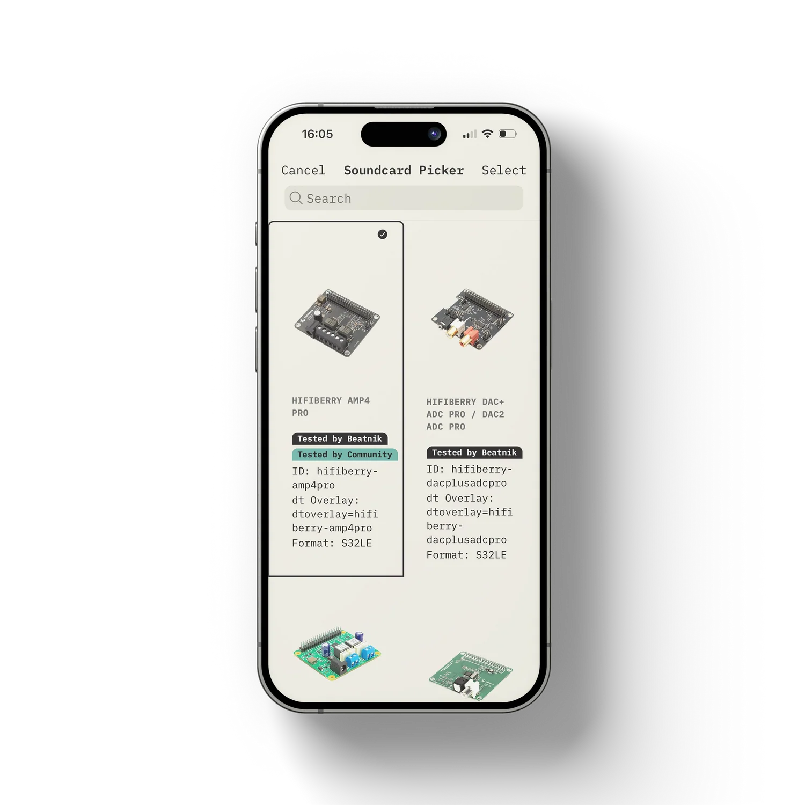

# Device Maintenance & Updates

## Device details and maintenance

::: warning 📸 Screenshot needed
Device details view with Now playing, Stream, Group Name and Clients.
:::

Open a group from the dashboard or **Devices > Device Groups**.

### Group controls

- **Now playing** card for the active stream (cover, stream, title, artist).
- **Stream** - switch the stream the group plays.
- **Group Name** - rename the group.
- **Clients** - select the clients that belong to the group.

### Speaker image

::: warning 📸 Screenshot needed
Speaker picker with type filter and search.
:::

Long-press the group card (dashboard or device details) or use **Choose Speakers** in the settings tab to open the speaker picker:

- Filter by type using the segments (**All** plus the available speaker types) or search by brand/model.
- Tap a speaker to select it and press **Save**. The image appears on the group card everywhere in the app. An empty option is available if you prefer no speaker image.

### Client details

::: warning 📸 Screenshot needed
Client information panel showing the Info tab.
:::

The client information panel has five tabs:

| Tab | Content |
|-----|---------|
| **Camilla DSP** | Live audio levels and DSP controls - see [Camilla DSP](./guide-camilladsp.md). |
| **Soundcard** | Current soundcard configuration and detected hardware. Tap **Choose Soundcard** to open the picker with images, search and "Tested by Beatnik / Community" badges. Use the refresh icon to re-read the hardware. |
| **Info** | System information: temperature, RAM usage, hostname, IP addresses, OS, model, storage type, MAC address, architecture, Wi-Fi SSID, band and frequency, link quality, signal and noise level, plus Snapcast client info (volume, muted, latency, connection state, last seen). |
| **Settings** | Snapcast server status (active/inactive), **Choose Speakers** and **Reboot Device** actions. |
| **Update** | Software update for this device - see [Updates](./guide-maintenance.md#updates). |

---

## Camilla DSP

Equalising, master volume, mixers and dynamics for each device are covered on their own page: [Camilla DSP and Equalising](./guide-camilladsp.md).

---

## Updates

::: warning 📸 Screenshot needed
Beatnik Update screen with installed versions and the update buttons.
:::

Open **Menu > Beatnik Update**, or the **Update** tab in the client details.

- The overview shows the installed versions and whether an update is currently running (*Update running...* / *Idle*).
- Update everything with one button, or update a single component: **bleno** (Bluetooth setup service), **controller** or **api**.
- **Refresh** reloads the current status. Failed updates are flagged so you can retry.

---

## Server status and maintenance

::: warning 📸 Screenshot needed
Server Status screen with the restart and reboot actions.
:::

Open **Menu > Server Status** (or tap the Wi-Fi button on the dashboard).

- **Information:** host name, IP address, OS/architecture, Snapserver version, and counts of groups, clients and streams.
- **Clean Offline Clients:** remove clients that are no longer connected.
- **JSON Server Response:** raw server state for debugging.
- **Restart** (does not reboot the device): Snapserver, all Snapclients, or Snapserver and Snapclients.
- **Reboot:** reboot the server, all clients, or the server and all clients. A confirmation alert is shown before restarts and reboots.

If the server cannot be reached, tap **Attempt to Connect** to retry.

---

## Network scanner

::: warning 📸 Screenshot needed
Network scanner listing servers and clients.
:::

Open **Menu > Search Devices**. The scanner uses mDNS/ZeroConf to find:

- **Servers** - Snapcast servers on your network. Tap **Set as Server** to use one.
- **Clients** - Beatnik devices, with their MAC address, model, version and RAM. Tap **View Device** to open its details.

Use the scan/stop buttons in the header or at the bottom. The scanner works only in the iOS and Android apps, not in a web browser.
